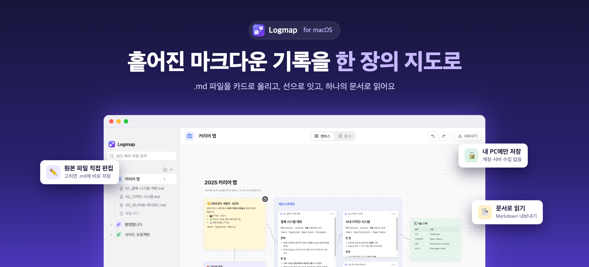
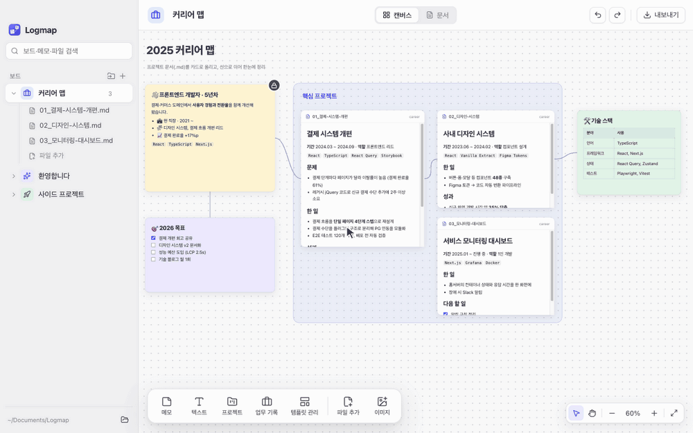
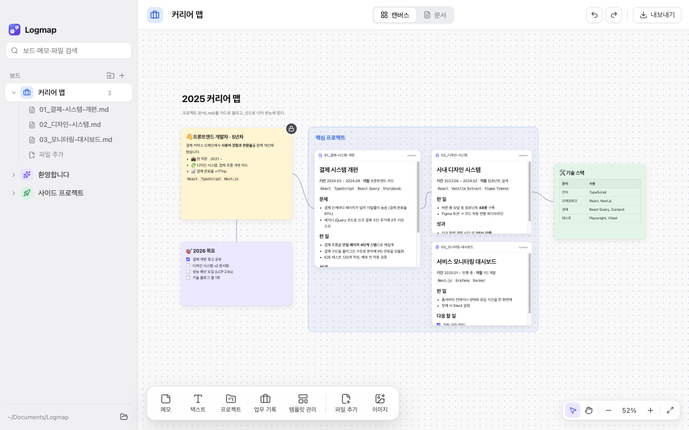
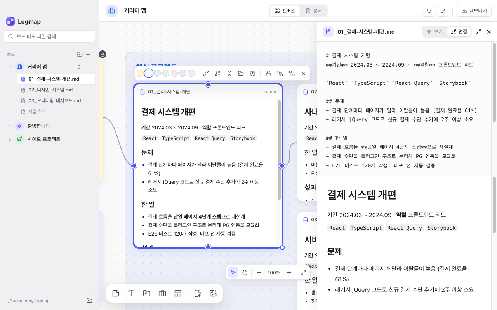
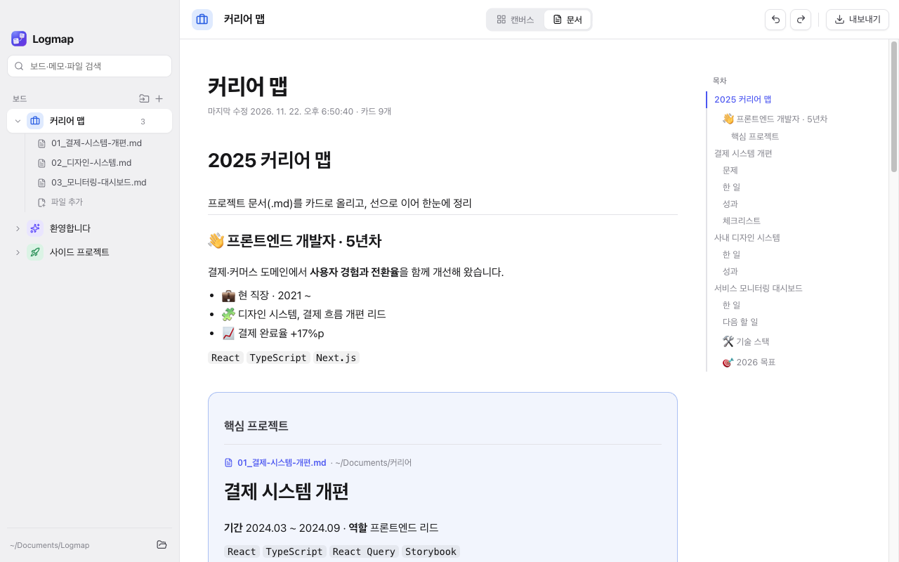

<p align="center">
  
</p>

<p align="center">
  <a href="../../releases/latest"></a>
  
  
</p>

<p align="center">
  <a href="https://github.com/Ukja2/Logmap/releases/latest/download/Logmap-0.1.0-arm64.dmg"><b>⬇︎ macOS용 내려받기 (.dmg)</b></a> &nbsp;·&nbsp;
  <a href="#설치하기">설치 방법</a> &nbsp;·&nbsp;
  <a href="#처음-5분-사용법">5분 사용법</a> &nbsp;·&nbsp;
  <a href="#자주-묻는-질문">FAQ</a>
</p>

프로젝트 기록, 업무 일지, 서비스 메모처럼 여러 폴더에 흩어진 `.md` 파일을 **하나의 보드 위 카드로 모아** 보는 macOS 앱이에요.
관련 있는 카드끼리 선으로 잇고, 카드를 열어 고치면 원본 파일이 바로 바뀌어요.
다 정리한 보드는 한 편의 문서로 읽거나 Markdown 파일로 내보낼 수 있어요.

<p align="center">
  
</p>

---

## 이런 분께 필요해요

> "프로젝트 기록은 여기, 업무 일지는 저기, 서비스 메모는 또 다른 폴더에…"
> "이력서 쓸 때마다 파일을 하나씩 열어 보면서 정리하느라 시간이 걸려요."

Logmap은 이렇게 **여러 폴더에 흩어진 기록을 한 화면에 모아** 보여 줍니다.

- 📌 **한눈에 보기**: 파일들을 넓은 화이트보드에 카드로 펼쳐 놓고, 관련 있는 것끼리 선으로 잇습니다.
- ✏️ **그 자리에서 고치기**: 카드를 열어 고치면 **원래 파일이 바로 바뀝니다.** 복사본을 따로 관리할 필요가 없어요.
- 📄 **문서로 읽기**: 버튼 하나로 화이트보드를 위에서 아래로 읽는 문서로 바꿔 볼 수 있어요.
- 🔒 **내 PC에만 저장**: 회원가입·인터넷 연결이 필요 없고, 데이터가 외부로 나가지 않아요.

## 먼저 알아 두면 좋은 4가지

| 용어 | 뜻 |
|---|---|
| **보드** | 카드를 올려 두는 넓은 화이트보드. 주제별로 여러 개 만들 수 있어요. (예: "커리어 맵", "운영 중인 서비스") |
| **카드** | 보드 위에 놓는 조각. **메모**, **텍스트**(제목처럼 쓰는 글), **이미지**, **파일 카드**(내 PC의 `.md` 파일) 네 종류가 있어요. |
| **편집 패널** | 파일 카드를 열면 오른쪽에 나타나는 편집 화면. 고치는 대로 카드와 원본 파일에 반영돼요. |
| **문서 보기** | 보드의 카드를 위→아래 순서로 이어 붙여 하나의 문서처럼 읽는 화면이에요. |

## 화면 둘러보기

### 1. 보드
카드를 자유롭게 놓고 선으로 연결해요. 여러 카드를 **그룹**으로 묶으면 함께 움직여요.
왼쪽 목록에서 보드 이름 옆 ▸를 누르면 그 보드에 들어 있는 파일이 보여요.



### 2. 편집 패널
파일 카드를 **더블클릭**하면 오른쪽에서 열려요. 왼쪽은 원문, 아래(또는 오른쪽)는 미리보기예요.
보드를 보면서 고칠 수 있고, 저장은 자동으로 돼요.



### 3. 문서 보기
위쪽 **문서** 버튼을 누르면 보드 전체가 한 편의 문서가 돼요. 오른쪽에 목차도 생겨요.



## 처음 5분 사용법

1. **보드 만들기**: 왼쪽 "보드" 옆 **+** 를 누르세요. 처음 실행하면 사용법이 담긴 "환영합니다" 보드가 이미 있어요.
2. **파일 올리기**: Finder에서 `.md` 파일을 보드로 **끌어다 놓으세요.** 폴더째 올리고 싶다면 "보드" 옆 폴더 아이콘을 누르면 돼요.
3. **메모 쓰기**: 빈 곳을 **더블클릭**하면 새 메모가 생겨요. 다 쓰면 **Esc**.
4. **연결하기**: 카드를 누르면 테두리에 점이 생겨요. 점을 **끌어서** 다른 카드에 놓으면 선으로 이어져요.
5. **고치기**: 파일 카드를 **더블클릭** → 오른쪽 편집 패널에서 고치면 원본 파일에 바로 저장돼요.

> 💡 아래쪽 도구 모음에서 메모·텍스트·템플릿(프로젝트, 업무 기록 양식)·파일·이미지를 추가할 수 있어요.
> 버튼에 마우스를 올리면 설명과 단축키가 나와요.

## 자주 묻는 질문

<details>
<summary><b>원본 파일이 망가지거나 지워지지는 않나요?</b></summary>

보드는 파일의 **위치만** 기억해요. 보드나 카드를 지워도 원본 파일은 그대로 남고, 지운 보드는 휴지통으로 가요.
고친 내용은 원본 파일에 저장되니, 중요한 파일은 평소처럼 백업해 두세요.
</details>

<details>
<summary><b>VS Code나 Obsidian 같은 다른 프로그램과 같이 써도 되나요?</b></summary>

네. 다른 프로그램에서 파일을 고치면 Logmap의 카드도 자동으로 바뀌어요.
Obsidian 스타일의 콜아웃(`> [!note]`), `[[위키링크]]`, 문서 맨 위 속성(frontmatter)도 보기 좋게 표시해요.
</details>

<details>
<summary><b>데이터는 어디에 저장되나요?</b></summary>

`~/Documents/Logmap` 폴더예요. 왼쪽 아래 폴더 버튼을 누르면 Finder에서 열려요.

```
Logmap/
├── boards/          보드 (카드 위치, 메모 내용, 연결선)
├── assets/          보드에 붙여 넣은 이미지
├── exports/         내보낸 문서
└── templates.json   템플릿
```
</details>

<details>
<summary><b>인터넷 연결이 필요한가요? 내 기록이 밖으로 나가지 않나요?</b></summary>

필요 없어요. 계정도, 서버도, 사용 기록 수집도 없어요.
(문서 안에 인터넷 이미지 주소가 있으면 그 이미지를 보여 줄 때만 인터넷을 써요.)
</details>

<details>
<summary><b>메모를 진짜 파일로 바꿀 수 있나요?</b></summary>

메모를 선택하고 위쪽 툴바의 **.md 파일로 저장**을 누르면 돼요. 메모 속 이미지도 파일 옆에 함께 복사돼요.
</details>

<details>
<summary><b>원본 파일을 다른 폴더로 옮겼더니 카드에 "파일을 찾을 수 없어요"가 떠요.</b></summary>

카드에 있는 **파일 다시 연결**을 눌러 옮긴 파일을 고르면 돼요.
</details>

<details>
<summary><b>보드를 다른 사람에게 보여 주고 싶어요.</b></summary>

오른쪽 위 **내보내기**를 누르면 보드 전체가 `.md` 파일 하나로 저장돼요.
</details>

## 단축키

자주 쓰는 것만 모았어요.

| 하고 싶은 것 | 방법 |
|---|---|
| 새 메모 / 텍스트 | 빈 곳 더블클릭 / **T** |
| 편집 시작 / 끝내기 | 더블클릭 또는 **Enter** / **Esc** |
| 화면 이동 | 두 손가락 스크롤, **Space** + 드래그 |
| 확대·축소 / 전체 보기 | **⌘** + 스크롤, 핀치 / **⇧1** |
| 여러 개 선택 | 빈 곳 드래그, **⇧** + 클릭 |
| 그룹으로 묶기 / 풀기 | **⌘G** / **⇧⌘G** |
| 되돌리기 | **⌘Z** |

<details>
<summary>전체 단축키 보기</summary>

| 동작 | 키 |
|---|---|
| 선택 도구 / 손 도구 | V / H (한글 입력 상태에서도 동작) |
| 화면 이동 | 두 손가락 스크롤, Space + 드래그, 손 도구(H) |
| 확대 / 축소 | ⌘ + 스크롤, 핀치, ⌘+ / ⌘- / ⌘0 |
| 전체 보기 | ⇧1 |
| 새 메모 / 이어지는 메모 / 텍스트 | 빈 곳 더블클릭 / Tab / T |
| 여러 개 선택 | 빈 곳 드래그, ⇧ + 클릭 (⇧ + 드래그는 추가 선택), ⌘A |
| 그룹 / 그룹 해제 | ⌘G / ⇧⌘G (그룹 안 하나만 선택: ⌘ + 클릭) |
| 편집 시작 | 더블클릭 · Enter (파일 카드는 편집 패널로) |
| 편집 완료 | Esc · 바깥 클릭 (메모는 ⌘Enter, 텍스트는 Enter로도 완료 · ⇧Enter 줄바꿈) |
| 편집 패널: 즉시 저장 / 닫기 | ⌘S / Esc (입력 중이면 한 번 더) |
| 고정 / 해제 | ⌘L |
| 복제 / 삭제 | ⌘D / ⌫ |
| 실행 취소 / 다시 실행 | ⌘Z / ⇧⌘Z |
| 위치 미세 조정 | 방향키 (⇧ = 10px) |
</details>

## 설치하기

macOS(Apple Silicon, M1 이상)에서 쓸 수 있어요.

1. 이 저장소의 [**Releases**](../../releases) 페이지에서 `Logmap-…-arm64.dmg`를 내려받으세요.
2. dmg를 열고 `Logmap`을 **응용 프로그램** 폴더로 끌어다 놓으세요.
3. 처음 한 번은 아래 방법으로 실행을 허용해 주세요.

> ⚠️ **처음 열 때 경고가 나와요 — "휴지통으로 이동"은 누르지 마세요!**
> Logmap은 유료 Apple 개발자 인증서가 없는 무료 앱이라, 처음 열면 macOS가
> "Apple에서 확인할 수 없음" 경고와 함께 **휴지통으로 이동 / 완료** 버튼을 보여 줘요.
> 앱에 문제가 있는 게 아니니 **완료**를 누르고, 아래 둘 중 한 가지 방법으로 열어 주세요.

**방법 1. 터미널 (가장 빠르고 확실해요)**

터미널(⌘스페이스 → "터미널")을 열고 아래 한 줄을 붙여 넣은 뒤 Enter를 누르세요. 그다음 Logmap을 열면 바로 실행돼요.

```bash
xattr -dr com.apple.quarantine /Applications/Logmap.app
```

**방법 2. 시스템 설정**

1. 경고 창에서 **완료**를 누르세요.
2. **시스템 설정 → 개인정보 보호 및 보안**에서 아래로 내려 **"그래도 열기"**를 누르세요.
3. 비밀번호를 입력하고 **열기**를 한 번 더 누르면 다음부터는 그냥 열려요.

<details>
<summary>소스 코드로 직접 빌드하기</summary>

[Node.js](https://nodejs.org) 20.19 이상이 필요해요.

```bash
git clone <이 저장소 URL>
cd <저장소 폴더>
npm install
npm run dist
```

끝나면 `release/mac-arm64/Logmap.app`과 설치용 `.dmg`가 만들어져요.
</details>

## 개발자를 위한 정보

<details>
<summary>개발 명령어</summary>

| 명령 | 설명 |
|---|---|
| `npm run dev` | 개발 모드 (Vite HMR + Electron) |
| `npm start` | 빌드 후 실행 |
| `npm run build` | 타입 검사 + 렌더러 빌드 |
| `npm run dist` | `release/`에 `Logmap.app`과 `.dmg` 생성 |

`LOGMAP_DATA=/임시/경로 npm run dev`처럼 실행하면 다른 데이터 폴더로 테스트할 수 있어요.
</details>

<details>
<summary>프로젝트 구조</summary>

```
electron/
  main.cjs        창, 메뉴, 파일 읽기·쓰기 IPC, asset:// · localfile:// 이미지 프로토콜, 파일 감시
  preload.cjs     렌더러에 window.api 노출
  seed.cjs        처음 실행 시 만드는 "환영합니다" 보드와 기본 템플릿
src/
  App.tsx                         보드·파일·편집 패널 상태, 자동 저장, 실행 취소
  components/Canvas.tsx           캔버스 (카드, 텍스트, 연결선, 그룹, 도구)
  components/EditorPanel.tsx      보드 오른쪽 편집 패널
  components/MarkdownEditor.tsx   원문 + 미리보기 편집기 (편집 패널·파일 화면 공용)
  components/MarkdownView.tsx     마크다운 렌더링 (콜아웃, 위키링크, frontmatter)
  components/DocView.tsx          문서 보기
  components/FileViewer.tsx       파일 화면 (Finder에서 연 .md)
  components/Sidebar.tsx          보드 목록 · 보드별 파일 목록 · 검색
  components/TemplateManager.tsx  템플릿 관리
  hooks/useFileStore.ts           파일 내용 캐시 · 디스크 저장 (카드·패널·파일 화면이 함께 사용)
scripts/third-party-licenses.cjs  빌드 시 오픈소스 라이선스 고지(THIRD_PARTY_LICENSES.txt) 생성
build/icon.svg      앱 아이콘 원본 (벡터) · icon.png는 여기서 만든 1024px 이미지
docs/screenshots/   README 스크린샷·데모 GIF (예시 데이터)
```

**기술 스택**: Electron · React · TypeScript · Vite · react-markdown(remark-gfm) · lucide-react
</details>

<details>
<summary>보안 설계</summary>

- **렌더러 격리**: `contextIsolation`·`sandbox`를 켜고 Node.js API를 화면 코드에 노출하지 않아요. 화면은 미리 정해 둔 `window.api` 함수만 쓸 수 있어요.
- **파일 접근 제한**: 문서 읽기·쓰기는 `.md` `.markdown` `.mdx` `.txt`로만 제한하고, 이미지는 앱의 assets 폴더와 열어 본 문서의 폴더에서만 불러와요.
- **안전한 마크다운 렌더링**: 마크다운 속 HTML은 실행하지 않고, `javascript:` 같은 위험한 링크는 걸러내요. 외부 링크는 기본 브라우저로 열려요.
- **엄격한 CSP**: 배포 빌드에서는 인라인·외부 스크립트를 막고, 카메라·마이크 등 권한 요청은 모두 거절해요.
</details>
